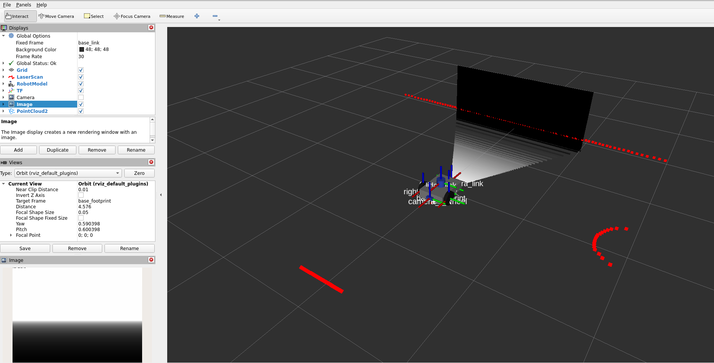
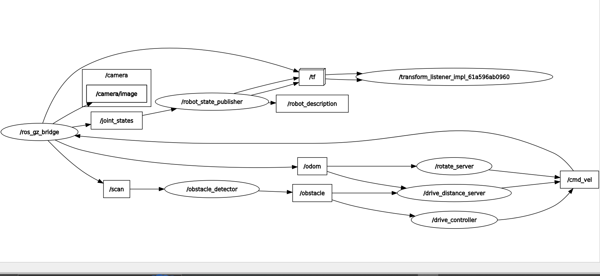

# ROS 2 Lab 1 – Robot Simulation and Control

## Overview

This project implements a mobile robot simulation using **ROS 2 Humble**, **Gazebo Sim**, and **RViz2**.

The lab explores fundamental ROS 2 concepts, including nodes, topics, parameters, custom messages, services, actions, sensor integration, and robot control.

The robot is equipped with LiDAR, an RGB camera, a depth camera, and an IMU. It can detect nearby obstacles, avoid collisions, execute rotation goals, and autonomously drive around a square.

## Technologies Used

- ROS 2 Humble
- Gazebo Sim 8
- RViz2
- Python
- CMake
- URDF / Xacro
- `ros_gz` bridge

## Project Structure

```text
lab1_exercise/
├── diffdrive_bot/
│   └── Robot simulation, controllers,
│       obstacle detection and drive action
│
├── lab_interfaces/
│   └── msg/
│       └── ObstacleInfo.msg
│
├── my_robot_interfaces/
│   ├── msg/
│   │   └── RobotStatus.msg
│   ├── srv/
│   │   └── SetTurnSpeed.srv
│   └── action/
│       └── Rotate.action
│
├── my_robot_nodes/
│   ├── launch/
│   │   └── square.launch.py
│   ├── my_robot_nodes/
│   │   ├── lidar_subscriber.py
│   │   ├── imu_subscriber.py
│   │   ├── turn_away.py
│   │   ├── rotate_server.py
│   │   └── square_driver.py
│   ├── package.xml
│   └── setup.py
│
└── docs/
    └── screenshots/
        ├── depth_camera_and_pointcloud.png
        └── rqt_graph_square_launch.png
```

## Implemented Features

### 1. Sensor Integration

Integrated the following sensors into the robot simulation:

- **LiDAR:** Detects obstacles and measures distances.
- **RGB Camera:** Provides camera images.
- **Depth Camera:** Publishes depth images and point cloud data.
- **IMU:** Provides orientation, angular velocity, and linear acceleration.

Sensor data is made available to ROS 2 through `ros_gz_bridge`.

Important topics include:

| Topic | Message Type |
|---|---|
| `/scan` | `sensor_msgs/msg/LaserScan` |
| `/camera/image` | `sensor_msgs/msg/Image` |
| `/depth_camera/image` | `sensor_msgs/msg/Image` |
| `/depth_camera/points` | `sensor_msgs/msg/PointCloud2` |
| `/imu` | `sensor_msgs/msg/Imu` |
| `/odom` | `nav_msgs/msg/Odometry` |

### 2. Obstacle Avoidance Node

Implemented the `turn_away` node to control robot movement based on obstacle information.

- Moves forward when no obstacle is too close.
- Turns away from nearby obstacles.
- Publishes velocity commands through `/cmd_vel`.
- Publishes robot status through `/robot_status`.

### 3. ROS 2 Parameters

Added configurable parameters to control robot movement:

| Parameter | Default Value | Description |
|---|---:|---|
| `forward_speed` | `0.2` | Forward linear speed (m/s) |
| `turn_speed` | `0.5` | Angular turning speed (rad/s) |
| `max_turn_speed` | `1.5` | Maximum permitted turning speed (rad/s) |

### 4. Custom Message

Created `RobotStatus.msg`:

```text
string state
float32 obstacle_distance
```

This message reports the robot's current state and its distance from the detected obstacle.

### 5. ROS 2 Services

Implemented two services.

**Enable or disable obstacle avoidance**

- Service: `/turn_away_enable`
- Type: `std_srvs/srv/SetBool`
- Enables or disables the obstacle avoidance controller.
- Publishes a zero velocity command when disabled.

**Configure turning speed**

- Service: `/set_turn_speed`
- Type: `my_robot_interfaces/srv/SetTurnSpeed`

```text
float32 turn_speed
---
bool success
string message
```

The service validates the requested speed and rejects values outside the allowed range.

### 6. Rotation Action Server

Implemented `rotate_server` to rotate the robot by a requested angle.

- Action: `/rotate`
- Type: `my_robot_interfaces/action/Rotate`
- Uses odometry data from `/odom` to track rotation.
- Publishes feedback containing the angle turned.
- Stops the robot when the target angle is reached.
- Rejects zero-angle goals.
- Supports goal cancellation.

Action definition:

```text
float32 angle
---
float32 turned
---
float32 turned
```

### 7. Square Driving Action Client

Implemented `square_driver` to autonomously drive the robot around a square.

The node:

1. Sends a `DriveDistance` goal to drive one side.
2. Waits for the result.
3. Sends a `Rotate` goal to turn left by 90 degrees.
4. Repeats the sequence four times.
5. Reports success after completing the square.

The side length is configurable through the `side_length` parameter.

## Installation and Setup

### Prerequisites

Make sure the following are installed:

- Ubuntu 22.04
- ROS 2 Humble
- Gazebo Sim
- `ros_gz`
- `colcon`
- `rosdep`

### 1. Create a ROS 2 workspace

```bash
mkdir -p ~/ros2_ws/src
cd ~/ros2_ws/src
```

Clone the repository:

```bash
git clone https://github.com/Mulu-Girmay/Robotics_lab1.git lab1_exercise
```

### 2. Source ROS 2

```bash
source /opt/ros/humble/setup.bash
```

### 3. Install dependencies

```bash
cd ~/ros2_ws
rosdep update
rosdep install --from-paths src --ignore-src -r -y
```

### 4. Build the packages

```bash
colcon build --symlink-install --packages-up-to my_robot_nodes \
  --allow-overriding my_robot_interfaces
```

### 5. Source the workspace

```bash
source install/setup.bash
```

**Note:** Source both ROS 2 and the workspace in every new terminal before running ROS commands.

## Running Each Lab Step

### Step 1: Sensor Integration

Launch the robot simulation:

```bash
ros2 launch diffdrive_bot gazebo.launch.py
```

Inspect the available sensor topics:

```bash
ros2 topic list
```

Check IMU data:

```bash
ros2 topic echo /imu
```

Check the depth camera image:

```bash
ros2 topic hz /depth_camera/image
```

Open RViz2 to visualize the depth image and point cloud.

### Step 2: Obstacle Avoidance

With the robot simulation running, open another terminal and start the obstacle avoidance node:

```bash
ros2 run my_robot_nodes turn_away
```

Inspect obstacle information and velocity commands:

```bash
ros2 topic echo /obstacle
ros2 topic echo /cmd_vel
```

### Step 3: ROS 2 Parameters

Inspect the node's parameters:

```bash
ros2 param list /turn_away
```

Change the forward speed:

```bash
ros2 param set /turn_away forward_speed 0.3
```

Change the turning speed:

```bash
ros2 param set /turn_away turn_speed 0.8
```

### Step 4: Custom Message

Inspect the robot status:

```bash
ros2 topic echo /robot_status
```

Inspect the custom message definition:

```bash
ros2 interface show my_robot_interfaces/msg/RobotStatus
```

### Step 5: ROS 2 Services

Enable obstacle avoidance:

```bash
ros2 service call /turn_away_enable std_srvs/srv/SetBool "{data: true}"
```

Disable obstacle avoidance:

```bash
ros2 service call /turn_away_enable std_srvs/srv/SetBool "{data: false}"
```

Update the turning speed:

```bash
ros2 service call /set_turn_speed my_robot_interfaces/srv/SetTurnSpeed "{turn_speed: 0.8}"
```

### Step 6: Rotation Action Server

Send a rotation goal of approximately 90 degrees:

```bash
ros2 action send_goal /rotate my_robot_interfaces/action/Rotate "{angle: 1.57}" --feedback
```

### Step 7: Square Driving Action Client

Launch the complete square-driving simulation:

```bash
ros2 launch my_robot_nodes square.launch.py
```

To specify a side length of 0.8 meters:

```bash
ros2 launch my_robot_nodes square.launch.py side_length:=0.8
```

The launch file starts the simulation and required controllers, action servers, and the square-driving action client.

The robot drives four sides and performs a 90-degree rotation after each side.

## Useful ROS 2 Commands

List active nodes:

```bash
ros2 node list
```

List topics:

```bash
ros2 topic list
```

Inspect robot status:

```bash
ros2 topic echo /robot_status
```

Inspect odometry:

```bash
ros2 topic echo /odom
```

List available services:

```bash
ros2 service list
```

List available actions:

```bash
ros2 action list
```

Inspect custom interfaces:

```bash
ros2 interface show my_robot_interfaces/msg/RobotStatus
ros2 interface show my_robot_interfaces/srv/SetTurnSpeed
ros2 interface show my_robot_interfaces/action/Rotate
```

## Testing and Verification

The following functionality was tested during development:

- Sensor topics and ROS-Gazebo bridges.
- Depth image and point cloud visualization in RViz2.
- Obstacle avoidance behavior.
- Runtime parameter updates.
- Custom message publishing.
- Enable/disable service.
- Turn-speed validation.
- Rotation action execution and feedback.
- Rejection of zero-angle rotation goals.
- Square-driving sequence using both action servers.

The square-driving test was successfully executed with a side length of `0.8` meters. The robot completed all four sides successfully.

## Screenshots

### Step 1: Depth Camera and Point Cloud in RViz2



### Step 7: ROS 2 Node Graph During Square Driving



## Issues Encountered and Solutions

### Gazebo Robot Spawning

Initially, the robot spawning process depended on a fixed delay before requesting the Gazebo create service. This could cause the spawn request to run before Gazebo was ready, depending on simulation startup time.

**Solution:** Replaced the fixed delay with a readiness check that waits until Gazebo exposes its robot creation service before spawning the robot. This makes the startup process more reliable.

### Development Environment

The simulation was developed and tested using ROS 2 Humble and Gazebo Sim in Ubuntu 22.04 under WSL. GUI applications such as Gazebo and RViz2 required additional display and runtime environment configuration.

## Learning Outcomes

Through this project, I practiced:

- Creating and managing ROS 2 nodes.
- Publishing and subscribing to topics.
- Working with ROS 2 parameters.
- Creating custom messages and services.
- Implementing action servers and clients.
- Integrating sensors with Gazebo.
- Using odometry for robot rotation tracking.
- Launching and coordinating multiple ROS 2 nodes.
- Debugging ROS 2 and Gazebo integration issues.

## Author

**Mulu Girmay Gebru**

